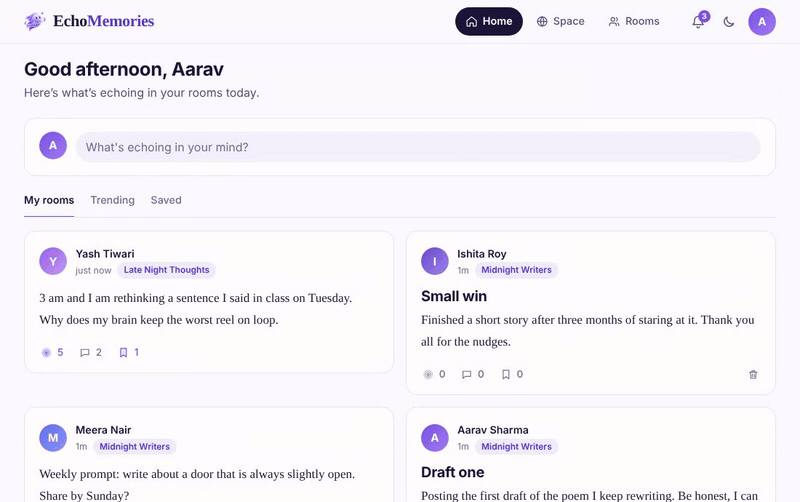
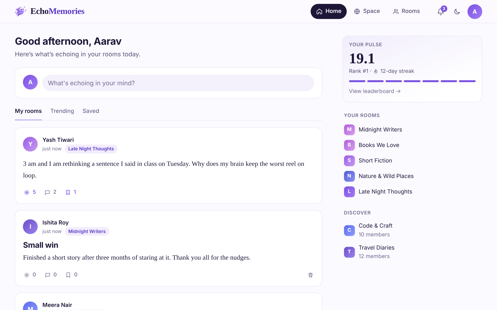
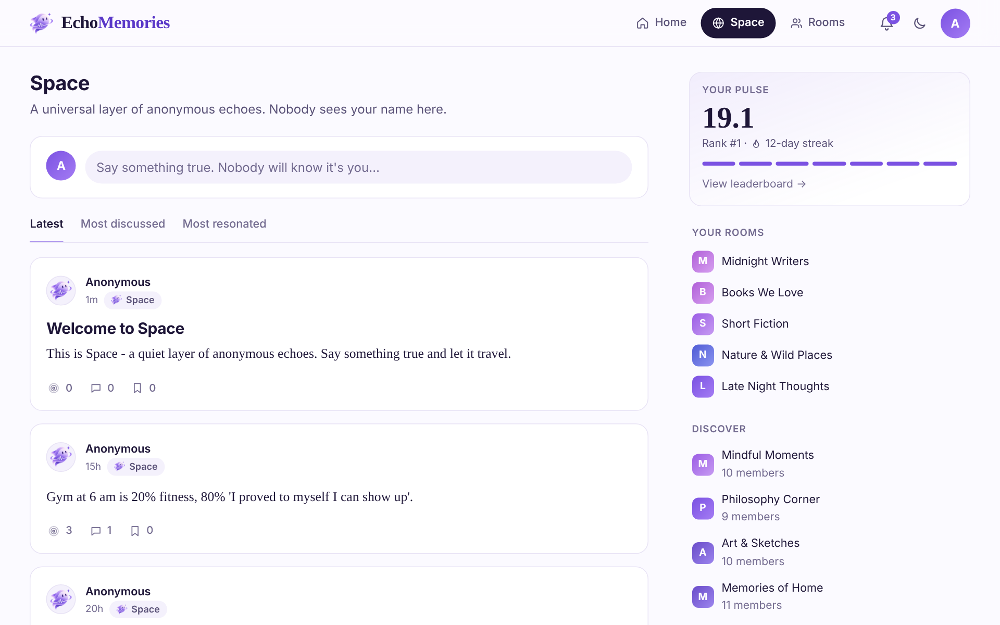
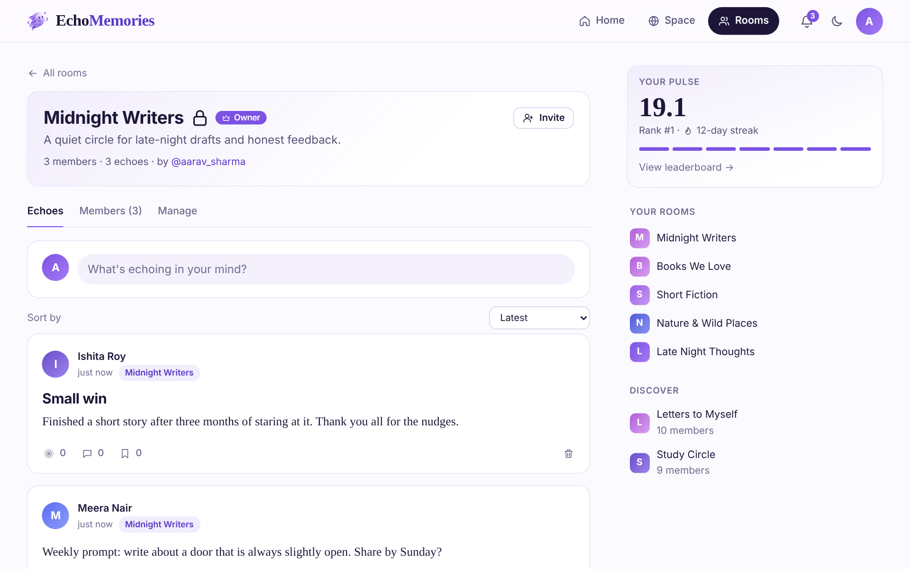
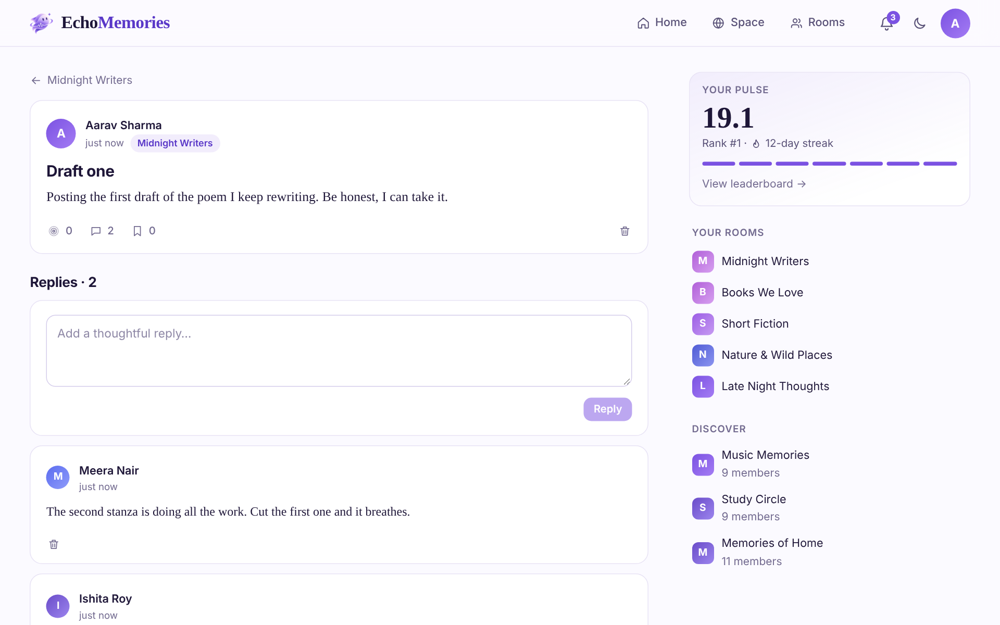
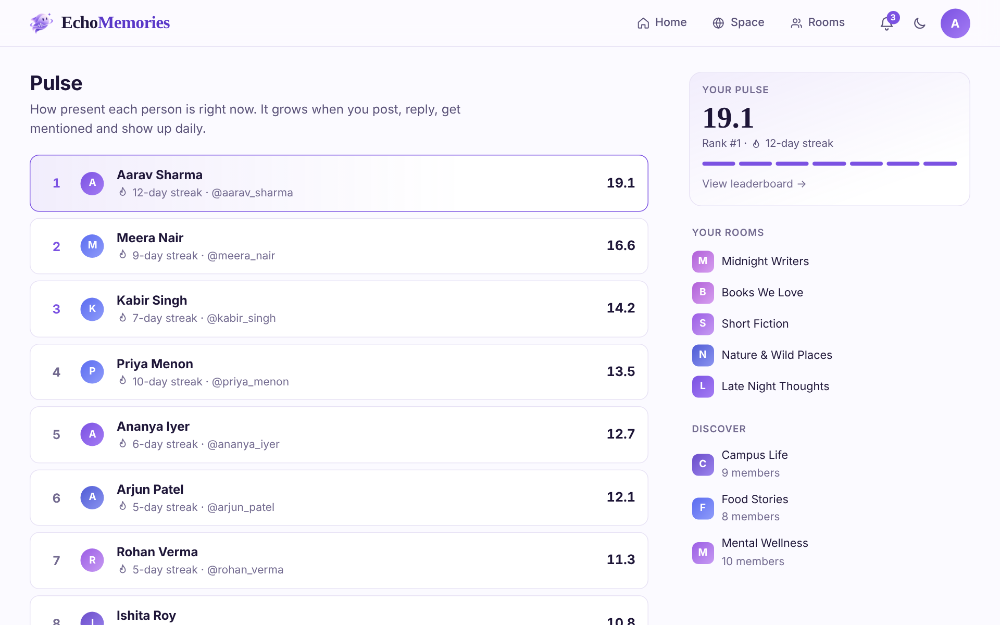
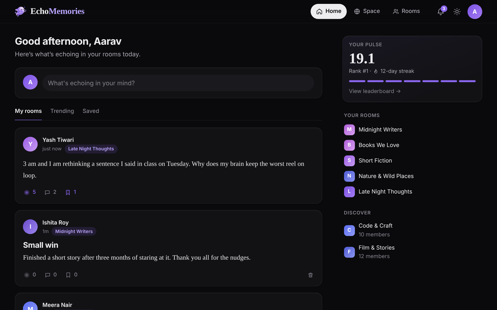

# EchoMemories

> Say it once. Let it echo.

EchoMemories is a small social platform I built around one idea: a place to share thoughts without the pressure of performing. You post **echoes**, write anonymously in **Space**, gather in **EchoRooms**, and build a presence score called **Pulse** just by showing up.

I'm Naveen, a BA Hindi (Hons.) student who likes code as much as language. This project is where the two meet. I designed the product, the database, the API and the interface myself.

<p align="center">
  
</p>

## What it does

- **Echoes:** short posts with an optional title. People can resonate (like), save, reply and @mention others.
- **Space:** a public feed where every echo is anonymous. The server never sends the author's identity. Only the author sees their own post marked as theirs.
- **EchoRooms:** public or private communities with their own feeds, roles (owner, admin, member), direct invites and shareable invite links.
- **Pulse:** a presence score that grows when you post, reply and get mentioned. It rewards daily streaks, slowly decays when you disappear, and feeds a public leaderboard.
- **Accounts:** email-verified signup with a one-time code, login with email or username, and password reset by emailed code.
- **Notifications:** replies, mentions, invites and room events show up in one place.
- **Feeds:** home (my rooms, trending, saved) and Space (latest, most discussed, most resonated).
- **Design:** responsive layout, light and dark theme, mobile bottom navigation.

## Screenshots

<table>
  <tr>
    <td></td>
    <td></td>
    <td></td>
  </tr>
  <tr>
    <td align="center">Home</td>
    <td align="center">Space</td>
    <td align="center">Room</td>
  </tr>
  <tr>
    <td></td>
    <td></td>
    <td></td>
  </tr>
  <tr>
    <td align="center">Replies</td>
    <td align="center">Pulse leaderboard</td>
    <td align="center">Dark mode</td>
  </tr>
</table>

## Tech stack

| Layer | Choice |
|---|---|
| Framework | Next.js 15 (App Router) and React 19 |
| Database | PostgreSQL with Prisma 7 |
| Auth | JWT in an httpOnly cookie, bcrypt for passwords |
| Email | Nodemailer (Gmail) for one-time codes |
| Styling | Plain CSS with design tokens, no UI library |

## How it is built

Every request travels the same path, which keeps the code easy to follow:

```
Page or component  →  api() helper  →  route handler  →  service  →  Prisma  →  PostgreSQL
```

- **Pages** (`src/app`) only render and call `api()`.
- **Route handlers** (`src/app/api/**/route.js`) check who is calling, read input and return JSON. A small `route()` wrapper handles login checks and errors.
- **Services** (`src/services`) hold all the rules: who is allowed to do what, limits, notifications. Nothing in them knows about HTTP.
- **Prisma** talks to the database, using transactions wherever several tables change together.

```
src/app/            pages and API routes
src/components/     UI: forms, header, feed, echo card, room tools
src/services/       business logic
src/libs/           prisma, session, cookies, rate limiting, mail, helpers
prisma/             schema, migrations, seed data
scripts/            dev environment checker and end-to-end tests
docs/               screenshots and demo
```

## Decisions I'm proud of

- **Anonymity is enforced on the server.** Space echoes still store their author, so they can be edited or deleted, but the response layer removes it before anything leaves the server. The author of an anonymous reply is hidden the same way.
- **Safer sessions.** The token lives in an httpOnly cookie and carries a fingerprint of the current password. Changing the password logs out every other device instantly.
- **One-time codes are never stored in plain text.** Only a keyed hash travels in a signed cookie, with a limited number of attempts.
- **No account guessing.** Login answers "Invalid credentials" whether the user or the password was wrong, and the forgot-password response is identical for registered and unknown emails.
- **Rate limits on sensitive actions** such as signup, login, codes, invites and search.
- **Fast pagination.** Lists ask for one extra row instead of running a count query, which is enough to know whether more pages exist.
- **Room rules in one place.** All role checks (owner, admin, member) live in a single file, so a permission can't be forgotten in a route.

## API overview

About 45 routes, all returning JSON, with errors always shaped as `{ "error": "message" }`.

| Area | Base path |
|---|---|
| Auth and sessions | `/api/auth/*` |
| Users and profiles | `/api/users/*` |
| Echoes, feeds, saved | `/api/echoes/*`, `/api/feed/*` |
| Replies and reactions | `/api/comments/*`, `/api/engagement/*` |
| Rooms, members, invites | `/api/rooms/*`, `/api/invites/*` |
| Search | `/api/search/*` |
| Notifications | `/api/notifications/*` |
| Pulse and daily jobs | `/api/pulse/*` |
| Health check | `/api/health` |

## Run it locally

You need Node 20.19 or newer and a PostgreSQL database.

```bash
npm install
cp .env.example .env     # fill in the values below
npm run setup            # apply migrations and seed sample data
npm run dev              # http://localhost:3000
```

| Variable | Purpose |
|---|---|
| `DATABASE_URL` | PostgreSQL connection string |
| `JWT_SECRET` | 32+ random characters, signs sessions and code cookies |
| `EMAIL_USER`, `EMAIL_PASS` | Gmail address and App Password for sending codes |
| `CRON_SECRET` | Protects the daily Pulse jobs |
| `APP_TZ_OFFSET_MINUTES` | Minutes ahead of UTC that define a "day" (default 330) |
| `NEXT_PUBLIC_SITE_URL` | Public site URL, used for share images |

With `EMAIL_USER` and `EMAIL_PASS` empty, codes are printed in the server console during development.

Other useful commands: `npm run db:seed` (re-run the sample data, safe to repeat), `npm run lint`, and `npm run test:e2e` (a script that exercises the room features against a running server and a development database).

## Author

**Naveen Kumar**: [GitHub](https://github.com/official-naveen) · [LinkedIn](https://www.linkedin.com/in/naveen-kumar-854737446)
