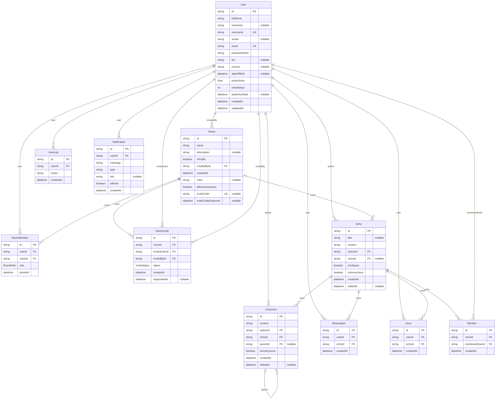

# EchoMemories

> Say it once. Let it echo.

**Live site:** [echomemories-three.vercel.app](https://echomemories-three.vercel.app)

EchoMemories is a small social app where you can share thoughts without feeling watched. You write short posts called **echoes**, post anonymously in **Space**, join communities called **EchoRooms**, and earn a presence score called **Pulse** just by showing up.

I'm Naveen, a BA Hindi (Hons.) student learning full-stack development. This is my biggest project so far. It's an assignment and portfolio project, not a real business, and I've tried to be straight in this README about what works well and what doesn't.

<p align="center">
  
</p>

## What you can do

- **Write echoes** with an optional title, edit them later, and reply to them. Replies can be answered too, so conversations form threads.
- **Mention people** with `@username`. Name suggestions appear as you type.
- **Resonate and save:** a like button and a bookmark.
- **Post anonymously.** In Space you are anonymous by default and can switch to showing your name. In rooms you can choose to post anonymously, unless a room admin has turned that off.
- **Join rooms**, public or private, with an owner, admins and members. Admins can write the room's rules, invite people directly or share an invite link.
- **Build Pulse:** the score goes up when you post, reply and get mentioned, rewards daily streaks, slowly fades if you disappear, and feeds a leaderboard.
- **Sign up safely** with an emailed one-time code, log in by email or username, and reset your password by code.
- **Get notifications** for replies, mentions, invites and room events.
- Scroll feeds endlessly, in light or dark theme, on desktop or phone.

## Screenshots

<table>
  <tr>
    <td></td>
    <td></td>
    <td></td>
    <td></td>
  </tr>
  <tr>
    <td align="center">Home</td>
    <td align="center">Space</td>
    <td align="center">Room</td>
    <td align="center">Replies</td>
  </tr>
</table>

## Tech stack

| Layer | Choice |
|---|---|
| Framework | Next.js 15 (App Router) and React 19 |
| Database | PostgreSQL (Neon) with Prisma 7 |
| Auth | JWT in an httpOnly cookie, bcrypt for passwords |
| Email | Nodemailer with Gmail for one-time codes |
| Hosting | Vercel, with two daily cron jobs for Pulse |
| Styling | Plain CSS, no UI library |

## How it is built

Every request follows the same path:

```
Page or component  →  api() helper  →  route handler  →  service  →  Prisma  →  PostgreSQL
```

- **Pages** (`src/app`) render the interface and call the API.
- **Route handlers** (`src/app/api`) check who is calling and return JSON.
- **Services** (`src/services`) hold the rules: who may do what, limits, notifications.
- **Prisma** talks to the database and uses transactions when several tables change together.

About 46 routes. Errors always look like `{ "error": "message" }`.

## Database

11 tables. An echo with no room belongs to Space. A reply can point at another reply through `parentId`, which is how threads work. Anonymity is a flag on the echo or reply: the author is still stored, and the server removes it from the response.

Every table with every column (PK = primary key, FK = foreign key, UK = unique). Click the image to zoom. It is generated from `prisma/schema.prisma` by `node scripts/er-diagram.mjs`, so it matches the real database.

<a href="docs/er-diagram.png"></a>

## Decisions I'm happy with

- **Anonymity is decided on the server.** The browser never receives the author of an anonymous echo or reply, so it can't be found by inspecting the page. Even a room admin can't see it.
- **Changing your password logs out every other device**, because the session token carries a fingerprint of the current password.
- **One-time codes are never stored in plain text.** Only a keyed hash is kept, with a limited number of attempts.
- **Login doesn't reveal whether an account exists.** Wrong user and wrong password give the same answer.
- **All room permissions live in one file** (`roomAccess.js`), so a route can't forget a check.
- **Pagination without counting.** Each list asks for one extra row to know whether another page exists.

## Honest limitations

- **Moderation is manual.** Room owners and admins can delete posts and remove members. There is no report button, no word filter, no mutes or bans, and a removed person can rejoin a public room. Admins also can't act on a person behind an anonymous post, because they can't see who it is.
- **Anonymity is only as strong as the database.** The author is stored so posts can be edited and deleted. Anyone with database access could see who wrote what.
- **The rate limiter lives in memory.** On Vercel each server instance keeps its own counters, so limits are approximate. A real deployment would use Redis.
- **Email goes through a personal Gmail account**, which has daily sending limits.
- **No image uploads and no real-time updates.** New content appears when you load or scroll the page, not live.
- **Testing is end-to-end scripts only** (about 130 checks in `scripts/`). There are no unit tests and no automatic CI yet.
- **It runs on free tiers**, so the first request after a quiet period can be slow. I haven't load-tested it.
- **The sample data is seeded**, so the busy-looking rooms in the demo are not real users.

## What I would do next

1. A report button and a simple review list for room admins.
2. Move the rate limiter to Redis.
3. Add unit tests and run the end-to-end checks automatically on every push.
4. Image uploads for avatars.

## Run it locally

You need Node 20.19 or newer and a PostgreSQL database.

```bash
npm install
cp .env.example .env     # fill in the values below
npm run setup            # apply migrations and seed sample data
npm run dev              # http://localhost:3000
```

| Variable | Purpose |
|---|---|
| `DATABASE_URL` | PostgreSQL connection string |
| `JWT_SECRET` | 32+ random characters, signs sessions and code cookies |
| `EMAIL_USER`, `EMAIL_PASS` | Gmail address and App Password for sending codes |
| `CRON_SECRET` | Protects the daily Pulse jobs |
| `APP_TZ_OFFSET_MINUTES` | Minutes ahead of UTC that define a "day" (default 330) |
| `NEXT_PUBLIC_SITE_URL` | Public site URL, used for share images |

With `EMAIL_USER` and `EMAIL_PASS` empty, codes are printed in the server console during development.

Useful commands: `npm run db:seed` (safe to repeat), `npm run lint`, `npm run test:e2e` (needs a running server and a development database).

## About how I built it

I used Claude, an AI assistant, to help write and review code while I decided what to build, tested it, and deployed it. I'm still learning, and I can walk through the parts above in detail.

## Author

**Naveen Kumar**: [GitHub](https://github.com/official-naveen) · [LinkedIn](https://www.linkedin.com/in/naveen-kumar-854737446)
